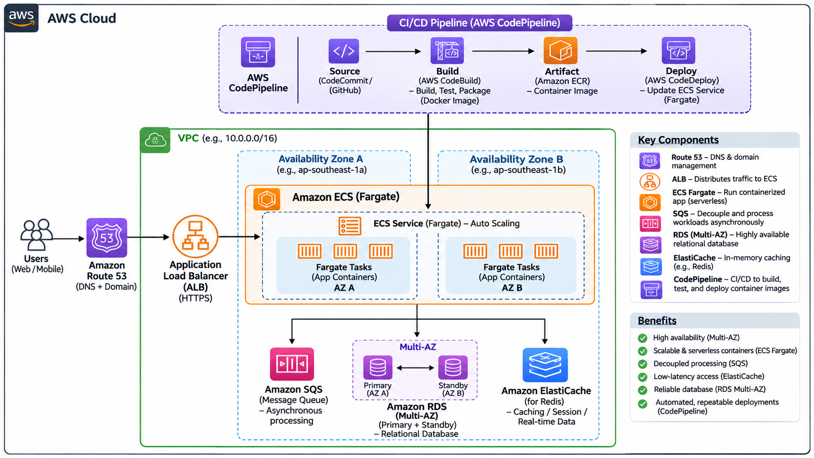
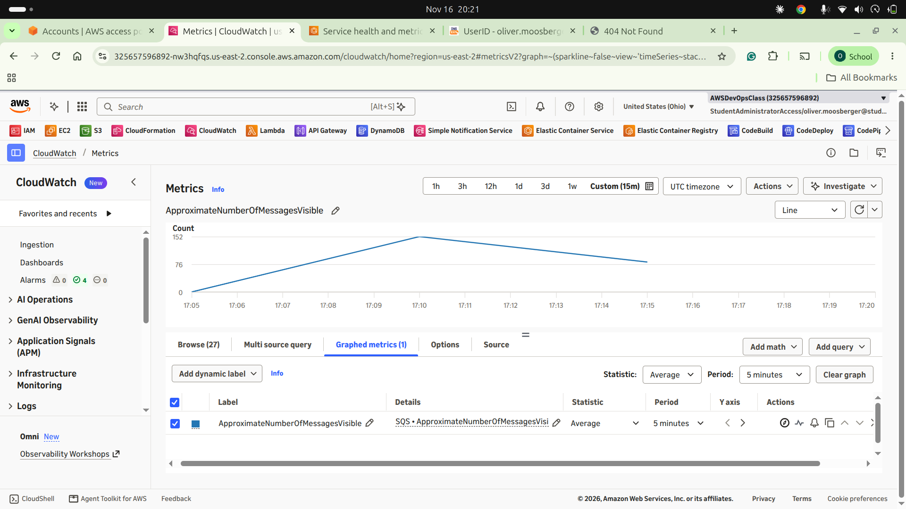
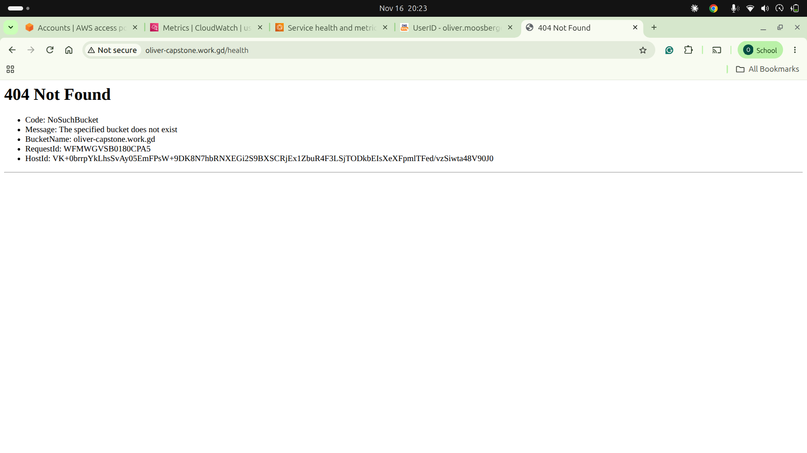

# Resilient Container Platform & CI/CD

**Region:** `us-east-2` (Ohio)
**Domain:** `oliver-capstone.work.gd`

## 1. Architecture Diagram

## 2. CI/CD Proof

The pipeline is fully automated: GitHub pushes trigger CodeBuild, which builds the web and worker Docker images, pushes them to ECR, and deploys to the ECS services.

## 3. Scaling Proof

**Scaling Activity:** 
We flooded the SQS queue with a burst of orders. The CloudWatch alarm triggered the Target Tracking policy, scaling the ECS Worker Service from 1 desired task to 3 desired tasks to drain the queue. *(Note: The CloudWatch graph shows the 5-minute average, which is why the peak appears lower than the raw burst).*

## 4. DR Runbook & Failover Proof

**AWS Backup Configuration:**
- **Schedule:** Daily at 05:00 UTC via `cron(0 5 ? * * *)`.
- **Retention:** 7 days.
- **Note:** The screenshot below shows an on-demand backup job because the cron schedule had not fired yet at the time of capture.

**Failover Simulation (Measured):**
- **BROKEN AT:** `2026-11-18 12:37:18 UTC` — health check path changed from `/health` to `/broken`.
- **FAILOVER AT:** `2026-11-18 12:39:27 UTC` — Route 53 served the S3 static error page.
- **MEASURED FAILOVER TIME:** **129 seconds** (3 failed health checks at 30s interval + DNS TTL).
- **RESTORED AT:** `2026-11-18 12:43:01 UTC` — health check reverted to `/health`, traffic returned to the ALB.

### Failover Screenshots
**Browser View (Graceful Degradation):**

**AWS Backup Proof:**

