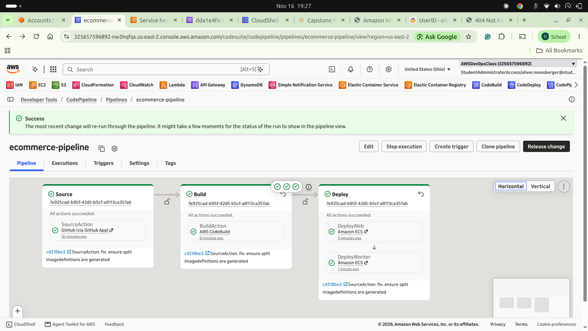
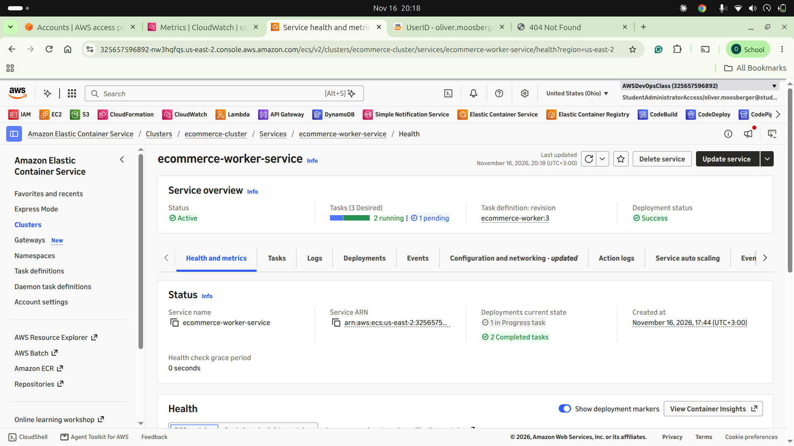
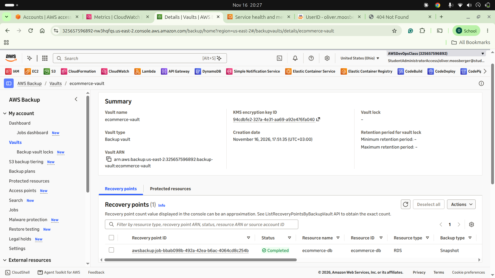

# Resilient Container Platform & CI/CD

**Region:** `us-east-2` (Ohio)
**Domain:** `oliver-capstone.work.gd`

## 1. Architecture Diagram

## 2. CI/CD Proof

## 3. Scaling Proof

## 4. DR Runbook & Failover Proof
Route 53 Health Checks trigger a failover to an S3 static error page when the primary ALB is unhealthy. AWS Backup is configured for daily RDS snapshots.

## 5. AWS Backup Proof

